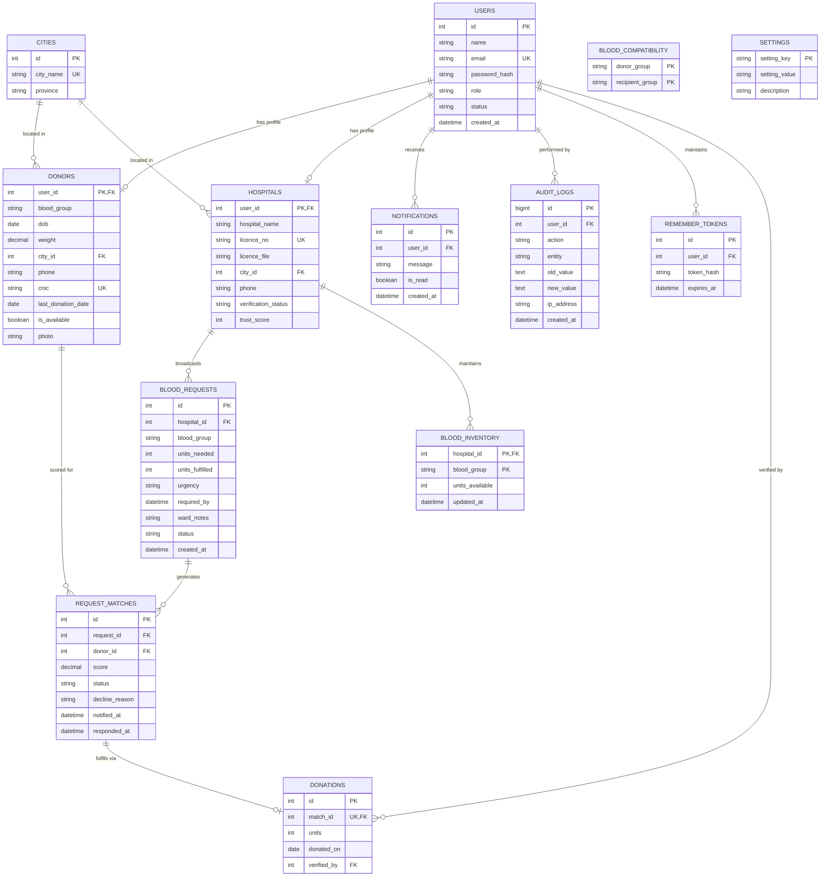
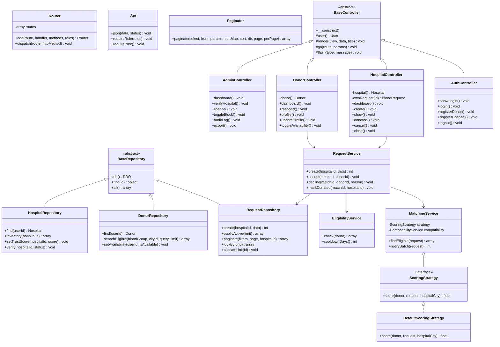
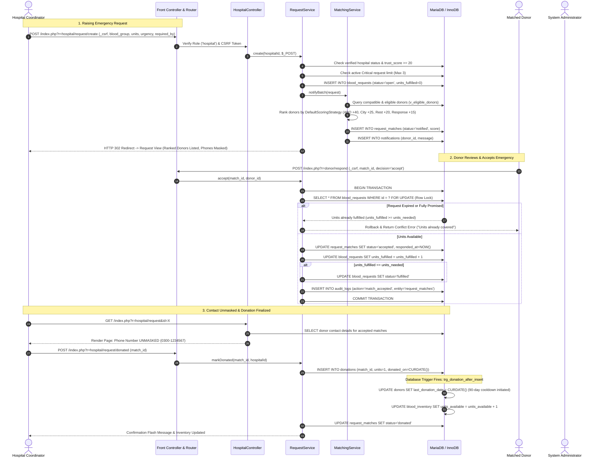
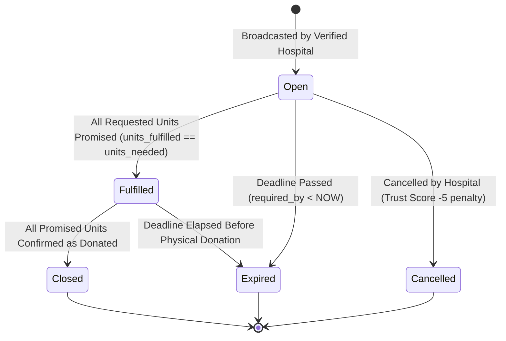

# DonorNexa
**Connecting Donors. Bridging Lives. Saving Hope.**

DonorNexa is a production-grade, framework-free emergency blood-donor coordination platform engineered in native PHP 8.1+ and MySQL/MariaDB (InnoDB). Developed for the Web Engineering Complex Engineering Problem (CEP) specification, the system coordinates time-critical blood donation requests across Pakistani healthcare networks, matching compatible, eligible, and geographically proximate donors in real time while enforcing medical privacy, concurrency controls, and comprehensive security standards.

---

## Table of Contents
1. [Project Overview & Key Features](#1-project-overview--key-features)
2. [System Architecture Diagram](#2-system-architecture-diagram)
3. [UML Use Case Diagram](#3-uml-use-case-diagram)
4. [UML Entity-Relationship Diagram (ERD)](#4-uml-entity-relationship-diagram-erd)
5. [UML Class Diagram](#5-uml-class-diagram)
6. [UML Sequence Diagram: Emergency Coordination Flow](#6-uml-sequence-diagram-emergency-coordination-flow)
7. [UML State Machine Diagram: Request Lifecycle](#7-uml-state-machine-diagram-request-lifecycle)
8. [UML Activity Diagram: Matching & Fulfillment Engine](#8-uml-activity-diagram-matching--fulfillment-engine)
9. [Installation & XAMPP Setup Guide](#9-installation--xampp-setup-guide)
10. [Seed Data & Test Credentials](#10-seed-data--test-credentials)
11. [Viva / Evaluation Demo Script](#11-viva--evaluation-demo-script)
12. [Folder Structure & Architectural Decoupling](#12-folder-structure--architectural-decoupling)
13. [Core Domain Engine & Algorithms](#13-core-domain-engine--algorithms)
14. [Security Hardening & OWASP Compliance](#14-security-hardening--owasp-compliance)
15. [Academic Integrity & Declarations](#15-academic-integrity--declarations)

---

## 1. Project Overview & Key Features

* **Data-Driven ABO/Rh Compatibility Engine**: Relational blood group compatibility matrix stored in the database without hardcoded conditional trees.
* **Deterministic Scoring & Multi-Tier Routing**: Donors scored out of 100 points based on compatibility (+40), geographic proximity (+25), rest period (+20), and response rate (+15). Broadcast pool expands dynamically based on urgency level (Normal: City, Urgent: Province, Critical: Nationwide).
* **Anti-Race-Condition Transactional Allocation**: `SELECT ... FOR UPDATE` row-level locks inside database transactions guarantee zero double-allocation of requested units even under high concurrency.
* **Medical Privacy & Masked Contact Records**: Donor mobile numbers remain masked (`0300-*******`) until an eligible donor explicitly accepts a request. Contact reveal events are logged in the immutable audit trail.
* **Institutional Trust Rating & Spam Mitigation**: Hospitals are evaluated with an institutional trust score (0-100). Frivolous cancellations trigger automatic trust deductions; trust scores below threshold prevent request posting. Maximum of 3 concurrent open Critical requests enforced via both application logic and database triggers.
* **Automated Expiry & Cooldown Enforcement**: Background maintenance engine expires outdated requests and resets non-responsive notifications. Database trigger automatically enforces 90-day cooldown upon confirmed donation.
* **Adaptive Dual Theme & Accessibility**: Native Light and Neutral Matte Dark mode toggle with persistent local preference, zero-neon high-contrast palettes, keyboard accessibility, and WCAG AA/AAA compliant text ratios across all devices.
* **Pure Native Stack (Zero External Frameworks)**: Engineered 100% in pure PHP 8.1+, MySQL/MariaDB (InnoDB), vanilla ES6+ JavaScript, and hand-written CSS3 Grid/Flexbox without third-party frameworks like Bootstrap, Tailwind, or Laravel.

---

## 2. System Architecture Diagram

DonorNexa implements a classic Model-View-Controller (MVC) architecture with clear separation between routing, controllers, domain services, data repositories, and the presentation layer.

```mermaid
flowchart TD
    subgraph ClientLayer ["Client Layer (Web & Mobile Browser)"]
        UI["Responsive HTML5 / CSS3 / Vanilla JS"]
    end

    subgraph Entrypoint ["HTTP Entry & Security Perimeter"]
        HTAccess[".htaccess (Deny Access to Private Dirs)"]
        FrontCtrl["public/index.php (Front Controller)"]
        SecHeaders["Security Headers & CSRF Verification"]
        Router["DonorNexa Core Router & RBAC Guard"]
    end

    subgraph ControllerLayer ["Application Controllers (src/Controllers)"]
        AuthCtrl["AuthController"]
        PubCtrl["PublicController"]
        DonorCtrl["DonorController"]
        HospCtrl["HospitalController"]
        AdminCtrl["AdminController"]
    end

    subgraph ServiceLayer ["Domain Services (src/Services)"]
        MatchSvc["MatchingService & ScoringEngine"]
        ReqSvc["RequestService (Transactions)"]
        EligSvc["EligibilityService (Cooldown / Age)"]
        RegSvc["RegistrationService"]
        ReportSvc["ReportService & CSV Export"]
        UploadSvc["UploadService (MIME Validation)"]
    end

    subgraph DataLayer ["Data Access Layer (src/Repositories)"]
        UserRepo["UserRepository"]
        DonorRepo["DonorRepository"]
        HospRepo["HospitalRepository"]
        ReqRepo["RequestRepository"]
        MatchRepo["MatchRepository"]
        AuditRepo["AuditRepository"]
        Paginator["Paginator (Whitelisted Sorting)"]
    end

    subgraph DatabaseLayer ["Database Persistence (MySQL 8 / MariaDB)"]
        Tables[("InnoDB Relational Tables")]
        Views[("View: v_eligible_donors")]
        Triggers[("Triggers: trg_donation_after_insert, trg_requests_critical_limit")]
    end

    subgraph PresentationLayer ["Presentation Layer (templates/)"]
        Layout["templates/layout.php"]
        Partials["templates/partials/ (cards, pagination, navigation)"]
        ViewsMap["Role Views (donor/, hospital/, admin/, public/)"]
    end

    UI -->|HTTP GET/POST / AJAX| HTAccess
    HTAccess --> FrontCtrl
    FrontCtrl --> SecHeaders
    SecHeaders --> Router
    Router -->|Dispatches Role-Guarded Route| ControllerLayer

    ControllerLayer --> ServiceLayer
    ServiceLayer --> DataLayer
    DataLayer --> DatabaseLayer
    DatabaseLayer --> DataLayer
    DataLayer --> ControllerLayer

    ControllerLayer --> PresentationLayer
    PresentationLayer -->|Rendered HTML Response| UI
```



---

## 3. UML Use Case Diagram

The platform establishes distinct roles with fine-grained access boundaries:

```mermaid
flowchart LR
    Guest(("Guest / Visitor"))
    Donor(("Eligible Donor"))
    Hospital(("Hospital Coordinator"))
    Admin(("System Administrator"))

    subgraph PublicUseCases ["Public / Guest Domain"]
        UC1["Browse Active Emergency Board"]
        UC2["View Portal Vital Stats via AJAX"]
        UC3["Register as Donor"]
        UC4["Register Hospital Account (Upload Licence)"]
        UC5["Authenticate / Sign In"]
    end

    subgraph DonorUseCases ["Donor Domain"]
        UC6["Toggle Live Availability"]
        UC7["Receive Emergency Match Alerts"]
        UC8["Accept / Decline Emergency Request"]
        UC9["View Personal Donation History & Cooldown"]
        UC10["Manage Donor Health Profile"]
    end

    subgraph HospitalUseCases ["Hospital Domain"]
        UC11["Broadcast Emergency Blood Request"]
        UC12["Inspect Real-Time Matched Donors"]
        UC13["Reveal Contact of Accepted Donors"]
        UC14["Mark Unit Donated & Fulfill Request"]
        UC15["Manage Hospital Blood Bank Inventory"]
        UC16["Notify Next Batch of Ranked Donors"]
    end

    subgraph AdminUseCases ["Administrator Domain"]
        UC17["Audit & Verify Hospital Licences (PDF Stream)"]
        UC18["Manage Users & Toggle Block / Active Status"]
        UC19["Configure System Parameters (Cooldown, Pool Size)"]
        UC20["Inspect Immutable Audit Trail"]
        UC21["Manage Geographic Cities & Provinces"]
        UC22["Export Operations Reports (CSV)"]
    end

    Guest --> UC1
    Guest --> UC2
    Guest --> UC3
    Guest --> UC4
    Guest --> UC5

    Donor --> UC6
    Donor --> UC7
    Donor --> UC8
    Donor --> UC9
    Donor --> UC10

    Hospital --> UC11
    Hospital --> UC12
    Hospital --> UC13
    Hospital --> UC14
    Hospital --> UC15
    Hospital --> UC16

    Admin --> UC17
    Admin --> UC18
    Admin --> UC19
    Admin --> UC20
    Admin --> UC21
    Admin --> UC22
```



---

## 4. UML Entity-Relationship Diagram (ERD)

The relational schema is normalized to 3rd Normal Form (3NF) with strict primary and foreign key constraints, check constraints, composite indices, and database-level triggers.



---

## 5. UML Class Diagram

DonorNexa is structured with object-oriented paradigms including inheritance, dependency injection, repository pattern, strategy pattern, and custom exception hierarchies.



---

## 6. UML Sequence Diagram: Emergency Coordination Flow

This diagram traces the complete lifecycle of an emergency blood request: from verified hospital creation, through deterministic scoring, notification, donor acceptance with row-level locking, contact reveal, and donation confirmation.



---

## 7. UML State Machine Diagram: Request Lifecycle

The lifecycle of each blood request progresses through well-defined finite states:



---

## 8. UML Activity Diagram: Matching & Fulfillment Engine

The complete end-to-end activity flow—from hospital request creation and algorithmic candidate scoring, through anti-race-condition row locking and database triggers:

```mermaid
flowchart TD
    Start(["Hospital Coordinator Initiates Blood Request"]) --> CheckAuth{"Is Hospital Verified & Trust Score >= 20?"}
    CheckAuth -- "No" --> DenyAuth["Reject Request & Flash Authorization Error"]
    CheckAuth -- "Yes" --> CheckCrit{"Is Urgency Level 'Critical'?"}

    CheckCrit -- "Yes" --> CritCount{"Active Critical Requests < 3?"}
    CritCount -- "No" --> DenyCrit["Reject: Maximum 3 Concurrent Critical Limit Reached"]
    CritCount -- "Yes" --> InsertReq["Insert blood_requests record with status='open'"]
    CheckCrit -- "No" --> InsertReq

    InsertReq --> EvalUrgency{"Evaluate Urgency Multi-Tier Radius"}
    EvalUrgency -- "Normal Urgency" --> PoolCity["Broadcast Pool: City Tier (Top N = 5 Donors)"]
    EvalUrgency -- "Urgent Urgency" --> PoolProv["Broadcast Pool: Provincial Tier (Top 2N = 10 Donors)"]
    EvalUrgency -- "Critical Urgency" --> PoolNat["Broadcast Pool: Nationwide Tier (Top 3N = 15 Donors)"]

    PoolCity --> CompatFilter["Filter Relational Compatibility (blood_compatibility Matrix)"]
    PoolProv --> CompatFilter
    PoolNat --> CompatFilter

    CompatFilter --> EligFilter["Filter Eligibility: Age 18-65, Weight >= 50kg, Rest Days >= 90"]
    EligFilter --> ScoreEngine["Compute Deterministic Donor Score (Max 100 Points):<br>ABO Match (+40) + Geo (+25) + Rest (+20) + Response (+15)"]
    ScoreEngine --> RankBatch["Sort Candidates Descending by Match Score"]
    RankBatch --> DispatchAlerts["Create request_matches & Insert Donor Dashboard Notifications"]

    DispatchAlerts --> WaitLoop["Public Coordination Board Broadcasts Request (Masked Phones)"]
    WaitLoop --> CheckTimeout{"Required-By Deadline Passed?"}
    CheckTimeout -- "Yes" --> AutoExpire["Expiry Engine Automatically Transitions Request to 'expired'"]

    CheckTimeout -- "No" --> DonorDecision{"Eligible Donor Action"}
    DonorDecision -- "Decline" --> LogDecline["Update match status='declined' with reason & Log Audit Trail"]
    DonorDecision -- "Accept" --> BeginTx["Begin PDO Transaction with Row-Level Lock:<br>SELECT * FROM blood_requests WHERE id = ? FOR UPDATE"]

    BeginTx --> CheckUnits{"Are Units Still Needed?<br>(units_fulfilled < units_needed)"}
    CheckUnits -- "No (Race Condition Mitigated)" --> RollbackTx["Rollback Transaction & Inform Donor: 'Units Already Covered'"]
    CheckUnits -- "Yes" --> AllocateUnit["Increment units_fulfilled = units_fulfilled + 1<br>Set match status='accepted'"]
    AllocateUnit --> CheckFulfilled{"units_fulfilled == units_needed?"}
    CheckFulfilled -- "Yes" --> SetFulfilled["Update blood_requests status='fulfilled'"]
    CheckFulfilled -- "No" --> CommitTx["Commit Transaction & Record match_accepted Audit Event"]
    SetFulfilled --> CommitTx

    CommitTx --> UnmaskContact["Hospital Console Unmasks Donor Phone (0300-1234567)"]
    UnmaskContact --> PhysicalDonation["Donor Attends Hospital & Completes Physical Phlebotomy"]
    PhysicalDonation --> MarkDonated["Hospital Coordinator Clicks 'Mark Donated'"]

    MarkDonated --> DBTrigger["Database Trigger Fires: trg_donation_after_insert"]
    DBTrigger --> EnforceCooldown["Set donor last_donation_date = CURDATE() (90-Day Cooldown)"]
    EnforceCooldown --> IncInventory["Increment hospital blood_inventory units_available (+1)"]
    IncInventory --> CheckAllDonated{"All Promised Units Donated?"}
    CheckAllDonated -- "Yes" --> CloseRequest["Update blood_requests status='closed'"]
    CheckAllDonated -- "No" --> WaitLoop
    CloseRequest --> Finished(["Emergency Lifecycle Completed"])
    AutoExpire --> Finished
    DenyAuth --> Finished
    DenyCrit --> Finished
    RollbackTx --> Finished
```



---

## 9. Installation & XAMPP Setup Guide

### Prerequisites
* **XAMPP** for Windows (PHP 8.1 or higher, Apache, MariaDB/MySQL).
* Required PHP extensions: `pdo_mysql`, `mbstring`, `fileinfo` (enabled by default in standard XAMPP). Optional: `gd` (for photo re-encoding).

### Step-by-Step Installation

1. **Clone or Copy Repository**:
   Place the project folder into your XAMPP web root directory:
   ```text
   C:\xampp\htdocs\DonorNexa\
   ```

2. **Start Services**:
   Launch **XAMPP Control Panel** and start both **Apache** and **MySQL**.

3. **Database Initialization**:
   Open **phpMyAdmin** (`http://localhost/phpmyadmin`) or MySQL Command Line and run:
   ```sql
   -- Create database and import schema (drops/creates donornexa DB, creates 11 tables, triggers, views)
   mysql -u root < sql/schema.sql

   -- Populate system with realistic seed data (40 donors, 5 hospitals, 20 requests, audit logs)
   mysql -u root < sql/seed.sql
   ```
   *Alternative via phpMyAdmin*: Open phpMyAdmin, click **Import**, select `sql/schema.sql`, and execute. Then select the generated `donornexa` database, click **Import**, select `sql/seed.sql`, and execute.

4. **Verify Database Configuration**:
   Inspect [config/db.php](file:///c:/Users/nandd/Downloads/DonorNexa/config/db.php) to confirm database connection parameters:
   ```php
   return [
       'host'    => '127.0.0.1',
       'port'    => 3306,
       'dbname'  => 'donornexa',
       'charset' => 'utf8mb4',
       'user'    => 'root',
       'pass'    => '',
   ];
   ```

5. **Filesystem Permissions**:
   Verify write permissions on the following application directories:
   * `public/uploads/photos/`
   * `storage/licences/`
   * `logs/`

6. **Launch Portal**:
   Navigate to the entrypoint URL in your web browser:
   ```text
   http://localhost/DonorNexa/public/
   ```
   *(Accessing `http://localhost/DonorNexa/` automatically redirects to `public/index.php`).*

---

## 10. Seed Data & Test Credentials

The database seed provides a pre-populated coordination ecosystem: 40 active donors, 5 hospitals across major cities, 20 varied emergency requests, historical donations, inventory levels, and comprehensive audit logs.

**Direct Sign In URL**: `http://localhost/DonorNexa/public/index.php?r=login`

| Role / Account Type | Email Address | Password | Profile Context & Test Scenarios |
|---|---|---|---|
| **System Administrator** | `admin@donornexa.pk` | `Admin@123` | Full administrative governance, hospital licence approval, user toggles, audit logs, CSV reports |
| **Hospital (Verified)** | `hospital.luh@donornexa.pk` | `Hospital@123` | Liaquat University Hospital, Hyderabad (Trust: 95/100, active requests & inventory) |
| **Hospital (Verified)** | `hospital.civil@donornexa.pk` | `Hospital@123` | Civil Hospital, Karachi (Trust: 100/100) |
| **Hospital (Verified)** | `hospital.lumhs@donornexa.pk` | `Hospital@123` | LUMHS, Jamshoro (Trust: 98/100) |
| **Hospital (Verified)** | `hospital.skm@donornexa.pk` | `Hospital@123` | Shaukat Khanum, Lahore (Trust: 100/100) |
| **Hospital (Pending)** | `hospital.sukkur@donornexa.pk` | `Hospital@123` | Ghulam Muhammad Mahar Hospital, Sukkur (For admin licence verification evaluation) |
| **Eligible Donors** | `donor1@example.com` to `donor39@example.com` | `Donor@123` | Donors with diverse blood groups, cities (Hyderabad, Jamshoro, Karachi, Lahore), and rest days |
| **Donor (Blocked)** | `donor40@example.com` | `Donor@123` | Account locked by administrator for policy non-compliance (evaluates 403 authorization guard) |

---

## 11. Viva / Evaluation Demo Script

Follow this structured workflow during academic examination to demonstrate full compliance with functional and non-functional requirements:

1. **Guest Experience & Live Emergency Coordination**:
   * Open `http://localhost/DonorNexa/public/`. Observe live counters loaded asynchronously via AJAX (`/api/stats.php`).
   * Toggle the **Theme Switcher** (sun/moon icon in navbar): observe instant switching between Light Mode and Neutral Matte Dark Mode (persists across reloads via `localStorage`).
   * Click **Emergencies** in the top navigation. Observe the live emergency board with urgency badges (Critical, Urgent, Normal) and real-time JavaScript countdown timers. Notice that all patient identities and contact numbers are strictly masked.
   * Click urgency filters (*All*, *Critical*, *Urgent*, *Normal*) to verify client-side filtering without page reloads.

2. **Hospital Workflow: Broadcast & Algorithmic Donor Matching**:
   * Sign in as **Liaquat University Hospital** (`hospital.luh@donornexa.pk` / `Hospital@123`).
   * Click **New request**. Post a blood request: Blood Group `O+`, Units `2`, Urgency `Critical`, Deadline `+12 Hours`, Ward Notes `Trauma Unit ICU`.
   * Upon submission, observe the ranked donor table: donors are scored (out of 100) using compatibility (+40), geographic proximity (+25), and rest period (+20). Notice contact numbers are masked (`0300-*******`).

3. **Donor Workflow: Notification & Concurrency Protection**:
   * In a private/incognito window, sign in as one of the notified donors (e.g., `donor1@example.com` / `Donor@123`).
   * On the Donor Dashboard, observe the emergency broadcast alert card.
   * Click **Accept**. The transaction runs with `SELECT ... FOR UPDATE` row-level locking.
   * Refresh the Hospital request page: the accepting donor's phone number is now unmasked. Check the audit log: this contact reveal action is permanently logged.

4. **Hospital Workflow: Fulfill Donation & Inventory Trigger**:
   * On the hospital's request page, click **Mark Donated**.
   * Observe:
     - The request unit fulfillment increments.
     - The hospital's blood bank inventory for `O+` automatically increments by 1.
     - The donor's profile automatically initiates a 90-day cooldown via database trigger `trg_donation_after_insert`.

5. **Spam Prevention & Concurrency Verification**:
   * Attempt to raise a 4th concurrent open Critical request from the same hospital: the system halts the operation with a validation exception (maximum 3 allowed).
   * Cancel an open request: note the hospital trust rating decreases by 5 points.

6. **Administrative Governance & Compliance**:
   * Sign in as **Administrator** (`admin@donornexa.pk` / `Admin@123`).
   * Navigate to **Hospitals** -> filter **Pending** -> inspect Ghulam Muhammad Mahar Hospital. Click **View Licence** to stream the PDF licence stored securely outside the web root. Click **Verify Hospital**.
   * Open **Audit Log**: review the chronological trail of login events, request creations, contact reveals, and status transitions.
   * Open **Analytics**: view Chart.js charts and click **Export Report** to download the CSV export with formula injection sanitization.

---

## 12. Folder Structure & Architectural Decoupling

The project strictly follows the suggested structure outlined in Section 9 of the official CEP specification (`23SW_WE_CEP_PHP_Project.pdf`):

```text
DonorNexa/
├── config/                  System configuration
│   ├── app.php              Scoring weights, cooldown settings, pagination limits
│   ├── db.php               Database credentials and PDO parameters
│   └── routes.php           Central route definition table with RBAC guards
├── src/                     BACKEND DOMAIN & MVC LOGIC
│   ├── Controllers/         Application controllers (Base, Auth, Donor, Hospital, Admin, Public)
│   ├── Core/                Framework engine (Router, Api, Database, Auth, Csrf, Session, Paginator, Validator)
│   ├── Exceptions/          AppException, ForbiddenException, UnauthorizedException, NotFoundException
│   ├── Models/              Domain entities (User, Donor, Hospital, BloodRequest, Match, Donation)
│   ├── Repositories/        PDO data access layer (User, Donor, Hospital, Request, Match, Audit, City)
│   ├── Services/            Business logic (MatchingService, RequestService, EligibilityService, UploadService)
│   ├── bootstrap.php        Class autoloader, timezone configuration, error handler initialization
│   └── helpers.php          Global security helpers: e(), csrf_field(), url(), asset(), icon()
├── public/                  PUBLIC WEB ROOT & FRONTEND ENTRYPOINT
│   ├── index.php            Front controller dispatches all routed web requests
│   ├── .htaccess            URL rewriting and security headers
│   ├── assets/              Static presentation assets
│   │   ├── css/             Modular stylesheets (common.css, public.css, auth.css, donor.css, hospital.css, admin.css)
│   │   └── js/              Client-side scripts (app.js, admin.js, vendor/chart.umd.js)
│   └── uploads/photos/      Public donor profile images
├── templates/               FRONTEND PRESENTATION VIEWS & PARTIALS
│   ├── layout.php           Master HTML5 wrapper with header, navigation, and footer
│   ├── partials/            Reusable UI components (emergency_card, pagination, notifications, modal)
│   ├── public/              Landing page and public emergency coordination board
│   ├── auth/                Login and registration interfaces
│   ├── donor/               Donor dashboard, profile editor, donation history
│   ├── hospital/            Hospital dashboard, request creation, request details, inventory manager
│   ├── admin/               Admin dashboard, hospital licensing, user management, audit logs, settings
│   └── errors/              HTTP 401, 403, 404, 500 error display templates
├── api/                     LIGHTWEIGHT REST JSON ENDPOINTS
│   ├── active_requests.php  Public active emergencies data
│   ├── admin_stats.php      Chart.js analytics data for administrator console
│   ├── availability.php     Asynchronous donor toggle with CSRF validation
│   ├── donor_search.php     Debounced donor directory lookup for verified hospitals
│   └── stats.php            Public landing page vital metrics
├── sql/                     DATABASE LAYER
│   ├── schema.sql           InnoDB 3NF schema, check constraints, foreign keys, views, triggers
│   ├── seed.sql             Comprehensive seed data (40 donors, 5 hospitals, 20 requests, logs)
│   └── queries.sql          8 advanced evaluation queries (JOINs, aggregates, subqueries)
├── storage/                 SECURE PRIVATE STORAGE (OUTSIDE WEB ROOT)
│   └── licences/            Private hospital medical licences (accessible solely by verified admin)
├── logs/                    SYSTEM LOGGING
│   └── error.log            Exception stack traces and unhandled error logs
├── cli/                     COMMAND-LINE INTERFACE UTILITIES
│   └── expire.php           Cron utility for auto-expiring overdue requests
├── index.php                Root gateway redirecting browser traffic to public/index.php
├── .gitignore               Git ignore configuration
└── README.md                Project documentation and UML diagrams
```

---

## 13. Core Domain Engine & Algorithms

### ABO/Rh Compatibility Engine
Blood compatibility is modeled relationally via table `blood_compatibility`. No nested switch-case statements are used:
* `O-` is the universal red-cell donor (can donate to all 8 blood groups).
* `AB+` is the universal red-cell recipient (can receive from all 8 blood groups).
* The compatibility engine loads the relational map into memory via `CompatibilityService` for efficient set lookups.

### Multi-Criteria Scoring Formula
When a hospital raises an emergency, `MatchingService` evaluates candidates using `DefaultScoringStrategy`:

$$\text{Final Score} = S_{\text{group}} + S_{\text{geo}} + S_{\text{rest}} + S_{\text{resp}}$$

* **Blood Group Compatibility ($S_{\text{group}}$)**: Exact ABO/Rh match awards **+40 points**; compatible non-identical match awards **+25 points**.
* **Geographic Proximity ($S_{\text{geo}}$)**: Donor in the same city as the hospital awards **+25 points**; same province awards **+10 points**.
* **Rest Period ($S_{\text{rest}}$)**: Days elapsed since last donation (minimum 90 days required). Scales linearly up to **+20 points** at 180 days:
  $$S_{\text{rest}} = \min\left(20, \left\lfloor \frac{\text{Days Rested} - 90}{4.5} \right\rfloor \right)$$
* **Historical Response Rate ($S_{\text{resp}}$)**: Ratio of accepted requests to total notifications awards up to **+15 points**.
* **Maximum Theoretical Score**: **100 points**.

### Dynamic Notification Broadcast Radius
To balance local availability with urgent clinical needs, notification pools scale automatically:
* **Normal Urgency**: Notifies top $N$ donors within the **same city**.
* **Urgent Urgency**: Notifies top $2 \times N$ donors within the **same province**.
* **Critical Urgency**: Broadcasts across the **entire country** to top $3 \times N$ eligible donors.
*(Default pool size $N$ is configurable via system settings; default $N=5$).*

### Double-Allocation Concurrency Defense
When a donor accepts a request, `RequestService::accept()` opens a PDO transaction with row-level locks:
```sql
SELECT * FROM blood_requests WHERE id = ? FOR UPDATE;
```
If two donors accept the final remaining unit at the exact same millisecond:
1. The first transaction acquires an exclusive row lock on the request record.
2. The second transaction blocks until the first completes.
3. Upon lock release, the second transaction re-evaluates `units_fulfilled >= units_needed`, detects full allocation, rolls back, and informs the second donor gracefully without corrupting the allocation counter.

---

## 14. Security Hardening & OWASP Compliance

DonorNexa implements comprehensive, defense-in-depth protections aligned with OWASP Top-10 standards:

1. **SQL Injection Prevention**:
   * 100% of dynamic queries use PDO prepared statements with parameter binding.
   * Sorting parameters in `Paginator` are checked against hardcoded whitelist maps (`$sortMap`); raw client input is never interpolated into `ORDER BY` clauses.

2. **Cross-Site Request Forgery (CSRF)**:
   * Every HTML form contains a hidden `_csrf` input field populated with a cryptographically secure 256-bit token (`bin2hex(random_bytes(32))`).
   * Asynchronous JavaScript requests transmit the token via the `X-CSRF-Token` HTTP header.
   * `BaseController` and `Router` verify both channels before executing state-changing POST operations.

3. **Cross-Site Scripting (XSS)**:
   * All dynamic view outputs are escaped through `e()` which wraps `htmlspecialchars($v, ENT_QUOTES, 'UTF-8')`.
   * Client-side JavaScript creates DOM elements using `textContent` rather than `innerHTML`.
   * Strict `Content-Security-Policy` header forbids unauthorized inline script injection.

4. **Authentication & Session Security**:
   * User passwords are encrypted with native PHP `password_hash()` utilizing BCrypt.
   * Constant-time dummy password hashing on non-existent usernames mitigates user enumeration timing attacks.
   * Brute-force throttling restricts failed login attempts to a maximum of 5 failures within 60 seconds.
   * Session fixation defense regenerates session IDs upon login (`session_regenerate_id(true)`).
   * Session cookies enforce `HttpOnly: true`, `SameSite: Lax`, and conditional `Secure: true`.
   * Persistent login ("Remember Me") stores only a SHA-256 hash of random tokens in the database.

5. **Insecure Direct Object Reference (IDOR)**:
   * Hospitals can view, close, or cancel only requests originating from their own institutional ID.
   * Donors can respond only to matches tied directly to their personal account.

6. **File Upload Security & Private Storage**:
   * Hospital licence PDFs are validated using `finfo(FILEINFO_MIME_TYPE)` magic byte inspection and restricted to verified MIME types.
   * Files are renamed with random 32-character hexadecimal hashes to eliminate directory traversal.
   * Licences are stored in `storage/licences/` outside the web root (`public/`) and are streamed strictly through an authenticated admin controller.

7. **HTTP Security Headers**:
   * `X-Frame-Options: DENY` (Clickjacking mitigation)
   * `X-Content-Type-Options: nosniff` (MIME sniffing prevention)
   * `X-XSS-Protection: 1; mode=block`
   * `Referrer-Policy: same-origin`
   * `Permissions-Policy: camera=(), microphone=(), geolocation=()`
   * `header_remove('X-Powered-By')` (Conceals server PHP runtime fingerprint)

---

## 15. Academic Integrity & Declarations

This software engineering project was developed for the Web Engineering Continuous Evaluation Problem (CEP), Department of Software Engineering. All architectural layers, database design, algorithms, responsive presentation templates, and security controls strictly adhere to the course syllabus and engineering guidelines.
